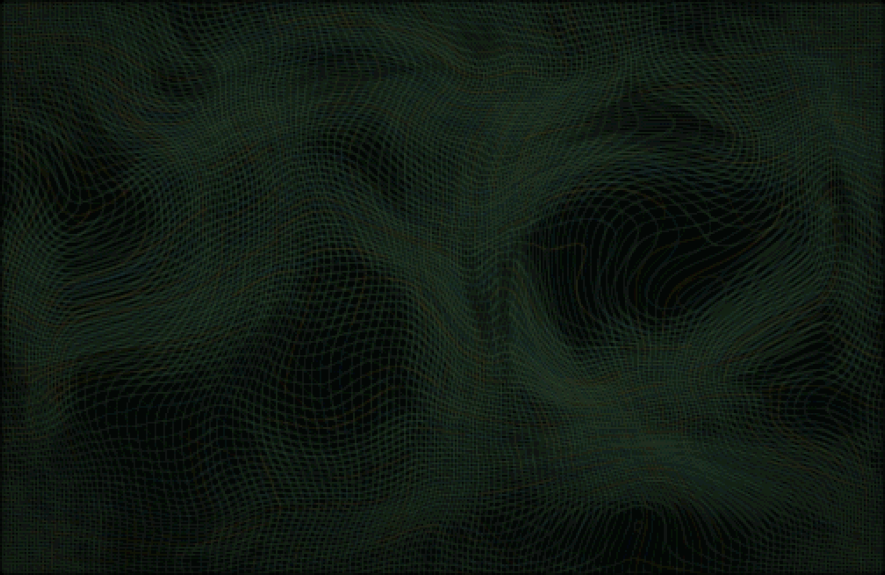

# Markade Wallpaper

The flowing net from [Markade](https://www.trademarkade.com) as a live Mac wallpaper. It drifts on its own, and every click sends a ripple through it. Click and hold to gather the cloth under the pointer and drag it around; let go and the ripple sets off.

## Download

1. Download `Markade-Wallpaper-1.1.zip` from the [latest release](https://github.com/dylanrowling/markade-wallpaper/releases/latest), unzip it and drag **Markade Wallpaper** to Applications.
2. Open it. macOS blocks it the first time. To allow it, go to **System Settings > Privacy & Security**, scroll down and click **Open Anyway**.

Needs macOS 14 or later.

## Using it

Click the grid icon in the menu bar for **Pause**, **Start at Login** and **Quit**.
